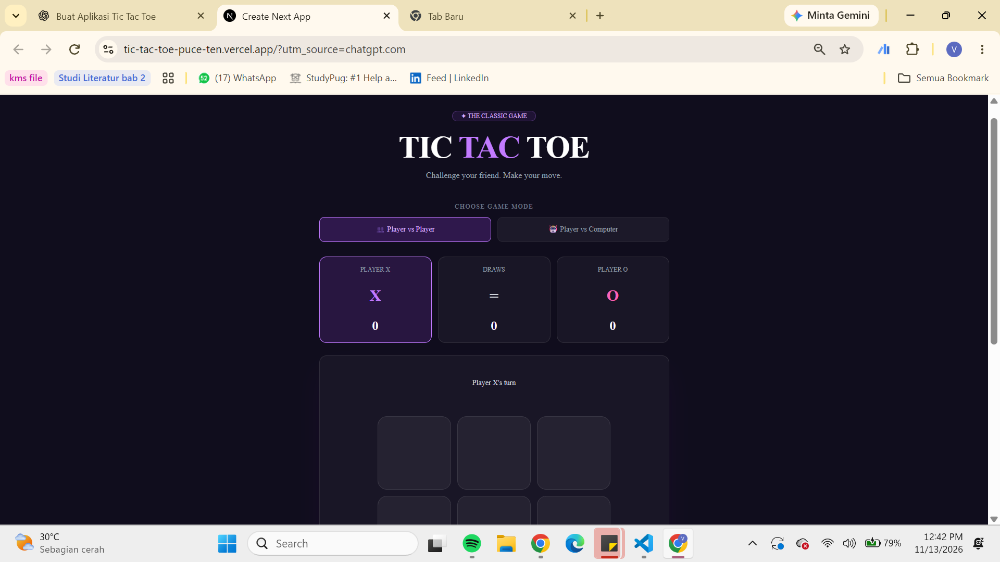
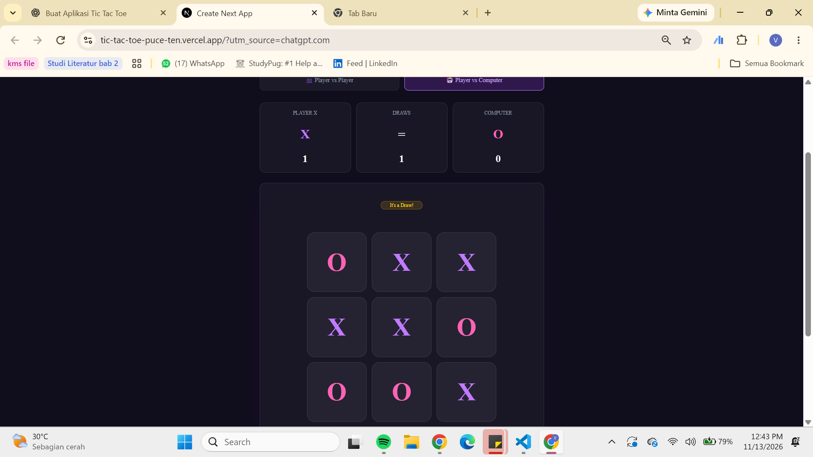
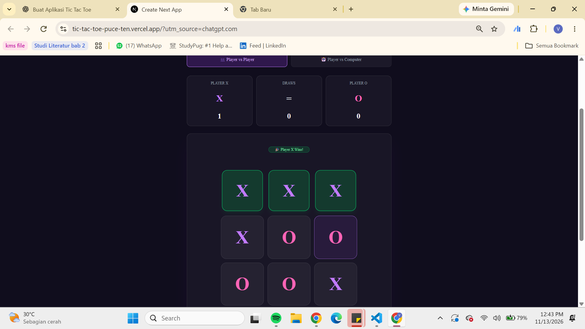

# Tic Tac Toe Game

A modern and interactive Tic Tac Toe web application built using Next.js, React, TypeScript, and Tailwind CSS. This game allows users to play against another player or challenge an AI opponent powered by the Minimax algorithm.

## Live Demo

Play the game here:

[**Tic Tac Toe - Live Demo**](https://tic-tac-toe-puce-ten.vercel.app)

## Preview

A classic Tic Tac Toe game with a modern dark-themed interface, featuring a purple-pink color palette and a responsive layout.

## Features

- **Player vs Player Mode** – Play against another player on the same device.
- **Player vs Computer Mode** – Challenge an AI opponent.
- **AI Opponent** – Uses the Minimax algorithm to determine strategic moves.
- **Winner Detection** – Automatically detects the winning player.
- **Draw Detection** – Identifies when the board is full without a winner.
- **Score Tracking** – Keeps track of player wins and draws.
- **Winning Highlight** – Highlights the winning combination.
- **New Game** – Starts a new round while keeping the current scores.
- **Reset Score** – Resets all game scores.
- **Responsive Design** – Provides a user-friendly experience across different screen sizes.

## Screenshots

### 1. Homepage



### 2. Player vs Computer Mode



### 3. Winner Display



## Tech Stack

- **Next.js** – React framework for web development.
- **React** – Library for building user interfaces.
- **TypeScript** – Programming language with static typing.
- **Tailwind CSS** – Utility-first CSS framework.
- **shadcn/ui** – Reusable UI components.
- **Vercel** – Platform for application deployment.

## Installation

Follow these steps to run the project locally.

### 1. Clone the Repository

```bash
git clone https://github.com/azzahrada14/tic-tac-toe.git
```

### 2. Navigate to the Project Directory

```bash
cd tic-tac-toe
```

### 3. Install Dependencies

```bash
npm install
```

### 4. Run the Development Server

```bash
npm run dev
```

Open your browser and visit:

http://localhost:3000

## Build

To create a production build, run:

```bash
npm run build
```

## Deployment

This application is deployed using **Vercel**.

Live URL: https://tic-tac-toe-puce-ten.vercel.app

## Repository

GitHub Repository:

https://github.com/azzahrada14/tic-tac-toe

## Author

**Azzahrada**

GitHub: [@azzahrada14](https://github.com/azzahrada14)

---

Developed as a Software Developer Technical Test.